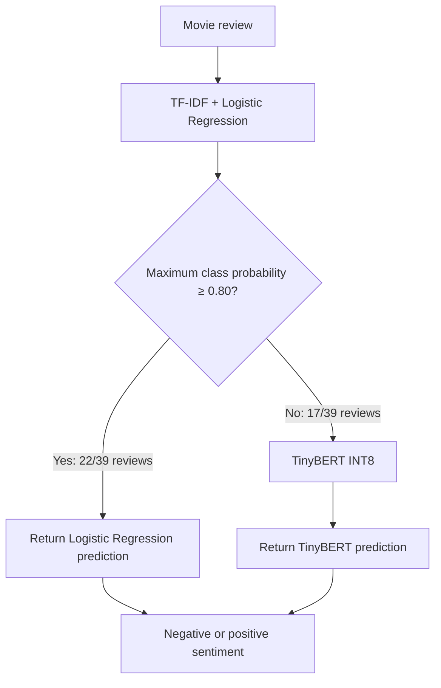
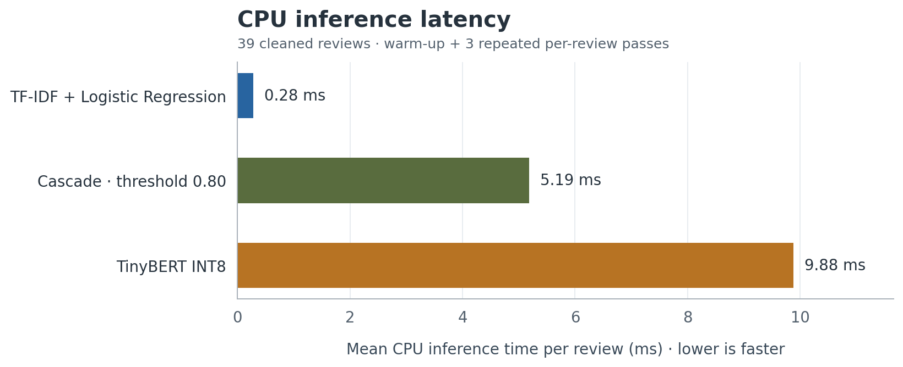
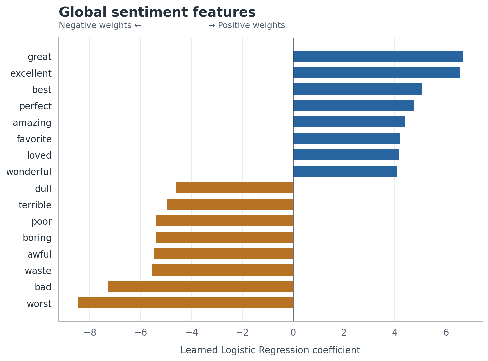
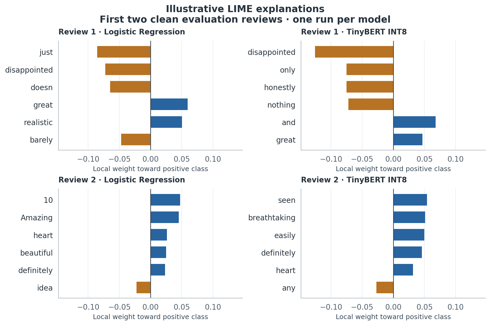

# Explainable & Efficient Sentiment Analysis

**How much model complexity does a sentiment classifier need—and how can we explain its decisions?**

An academic NLP project comparing a sparse linear model, an INT8 transformer, and a confidence-based cascade on IMDb movie reviews. The study connects predictive performance, CPU inference cost, and interpretable model behavior.

**Python · scikit-learn · PyTorch · Hugging Face Transformers · LIME**  
**Authors:** Simo Berrada Rekhami and Supriya Malla · Explainable AI course, 2025–26

[Results](#results) · [Architecture](#architecture) · [Explainability](#explainability) · [Run locally](#run-locally) · [Report](docs/report.pdf) · [Reproducibility](docs/REPRODUCIBILITY.md)

## At a glance

- **Three approaches:** TF-IDF + Logistic Regression, TinyBERT INT8, and a two-stage cascade.
- **47.5% lower measured latency:** the cascade averaged 5.19 ms/review versus 9.88 ms for TinyBERT alone.
- **56.4% of reviews used the fast path:** Logistic Regression returned the prediction for 22 of 39 examples.
- **Two explanation perspectives:** learned feature weights for global inspection and LIME for local prediction analysis.

> Results describe a **39-review cleaned evaluation sample**, measured on CPU in three repeated passes. They are exploratory results, not an estimate of performance on the full IMDb test benchmark. Latency savings are measured relative to TinyBERT INT8, not relative to Logistic Regression.

## The problem

Sentiment classification can use a fast, transparent linear model or a more complex transformer. This project asks what each choice costs, what a simple routing rule changes, and what the explanations reveal about individual predictions.

The engineering work includes a shared evaluation pipeline, removal of exact training/evaluation text overlap, probability-based routing, local model loading, and saved explanation artifacts. The emphasis is on inspectable experiments and explicit limitations.

## Architecture



| Component | Implementation | Role |
|---|---|---|
| Sparse baseline | TF-IDF unigrams/bigrams + L2 Logistic Regression | Fast predictions, class probabilities, inspectable feature coefficients |
| Transformer | Four-layer TinyBERT with dynamically quantized INT8 linear layers | Fallback model for uncertain sparse-model predictions |
| Cascade | Route using `max(p_negative, p_positive) >= 0.80` | Avoid a transformer call when the linear model passes the gate |
| Evaluation | Common per-review prediction loop; three timing passes after warm-up | Compare accuracy, binary F1, precision, recall, and mean latency |
| Explanations | Global coefficients and LIME perturbations | Inspect learned vocabulary and individual decisions |

The threshold uses model probabilities; calibration was not evaluated. The project uses a pretrained TinyBERT checkpoint and sentiment fine-tuning code. It does not implement a new knowledge-distillation algorithm.

## Results

Saved experiment: **16 April 2026**. Sample: **39 reviews, 20 negative and 19 positive**. F1, precision, and recall use the positive class (`1`).

| Model | Correct | Accuracy | Precision | Recall | Binary F1 | CPU ms/review |
|---|---:|---:|---:|---:|---:|---:|
| TF-IDF + Logistic Regression | 38/39 | 97.44% | 1.0000 | 0.9474 | 0.9730 | 0.28 |
| TinyBERT INT8 | 36/39 | 92.31% | 0.9444 | 0.8947 | 0.9189 | 9.88 |
| Cascade, threshold 0.80 | 37/39 | 94.87% | 1.0000 | 0.8947 | 0.9444 | 5.19 |



Source: [saved evaluation JSON](results/evaluation_clean_latest.json). The chart is generated directly from this file.

**Interpretation:** the cascade reduces latency relative to TinyBERT alone, but Logistic Regression is both faster and more accurate on this sample. The accuracy differences represent only one or two reviews. These results do not establish a general ranking of model families or a production deployment recommendation.

Latency reduction is calculated as `100 × (1 − 5.1869 / 9.8823) = 47.51%`. Hardware-dependent timings may change when rerun. The recorded experiment does not include latency percentiles, confidence intervals, energy consumption, or a memory comparison.

## Explainability

### Global: what vocabulary does the linear model associate with sentiment?

The learned coefficients identify features associated with positive and negative sentiment. For a specific review, the implementation also computes each present feature's TF-IDF value multiplied by its coefficient. A global coefficient alone is not that review's contribution.



### Local: what changes the model's prediction around one review?

LIME perturbs review words and fits a local surrogate. Saved explanations cover the **first five cleaned evaluation reviews** for both models; the figure shows the first two. Positive weights support the positive class in these explanation outputs.



These are qualitative diagnostics. There was no repeated-seed stability or explanation-faithfulness study. Integrated Gradients was planned but not run because only a quantized TinyBERT checkpoint was retained; the available explanation workflow uses LIME.

## Data and evaluation integrity

The local training file contains **30,000 reviews**. An initial 100-review candidate sample had **61 exact text overlaps** with that training file. Removing those overlaps and checking the remaining texts for duplicates produced the 39-review sample used here.

This is a project-specific partition. It is not the official IMDb 25,000-review test split. Exact text matching also does not rule out near-duplicates or undocumented historical exposure during model development.

See [data provenance and hashes](data/README.md) and the [split manifest](data/split_manifest.json). The original training file is needed to rerun the overlap-removal step; the cleaned evaluation CSV is included for inference.

## Run locally

Use Python 3.12 to match the locally checked environment. Run commands from this repository's root.

```bash
python3.12 -m venv .venv
source .venv/bin/activate
python -m pip install -r requirements-lock.txt
```

### 1. Explore the saved results without model weights

```bash
python scripts/verify_portfolio.py
python scripts/generate_report_figures.py
```

This reproduces the figures from saved JSON. It does not rerun model inference.

### 2. Restore the trained artifacts and run inference

The handoff includes a separate `xai-sentiment-models.zip`. Place it beside the repository directory, then extract it from the repository root:

```bash
unzip ../xai-sentiment-models.zip
python demo.py --model cascade --text "The performances were excellent and the story was engaging."
python evaluate.py --models logreg tinybert cascade --out-dir results/reruns
```

The CLI prints the actual prediction, model probability, and route when applicable. The quoted review is an illustrative input, not an evaluated result. Required artifact paths and loading details are documented in [models/README.md](models/README.md). No hosted model download is assumed.

### 3. Generate fresh explanations

```bash
python explain_logreg.py --examples data/eval_clean.csv --n-examples 5 --lime --out results/reruns/logreg_features.json --lime-out results/reruns/logreg_lime.json
python explain_tinybert.py --examples data/eval_clean.csv --n-examples 5 --method lime --out results/reruns/tinybert_lime.json
```

LIME reruns can produce different attributions because the original workflow does not fix its perturbation seed. Training and rebuilding the evaluation sample are described in [Reproducibility](docs/REPRODUCIBILITY.md).

## Repository guide

```text
.
├── README.md
├── demo.py                       # Single-review prediction CLI
├── evaluate.py                   # Shared metrics and timing protocol
├── explain_logreg.py             # Coefficients and local LIME explanations
├── explain_tinybert.py           # LIME; documented unavailable IG path
├── src/                         # Models, cascade, and shared configuration
├── data/                        # Candidate/clean samples and split provenance
├── models/                      # Artifact instructions and local architecture
├── results/                     # Saved experiment and explanation evidence
├── scripts/                     # Split creation, figures, portfolio verification
├── docs/
│   ├── assets/                  # PNG and PDF figures generated from JSON
│   ├── report.pdf               # Report with corrected captions and qualifications
│   ├── report-source/           # LaTeX source and conference style
│   ├── REPRODUCIBILITY.md
│   └── GITHUB_SETUP.md          # Repository description, topics, and upload steps
└── .github/workflows/           # Lightweight source and evidence checks
```

## Limitations and next steps

- Evaluate a larger independent sample and quantify uncertainty in accuracy differences.
- Tune the routing threshold on separate validation data and assess calibration.
- Measure latency distributions, throughput, model memory, and energy directly.
- Preserve a float checkpoint before quantization to enable gradient-based explanations.
- Repeat LIME with multiple seeds and test explanation stability.

## Credits and references

This portfolio packages the Explainable AI project by **Simo Berrada Rekhami and Supriya Malla**, using code and artifacts from the earlier Green AI project. Model comparisons and results are team work; this repository does not assign an unsupported individual ownership breakdown. See [provenance and reuse notes](NOTICE.md).

- [IMDb Large Movie Review Dataset — Maas et al.](https://ai.stanford.edu/~amaas/data/sentiment/)
- [TinyBERT: Distilling BERT for Natural Language Understanding — Jiao et al., 2020](https://aclanthology.org/2020.findings-emnlp.372/)
- [LIME — original implementation by Marco Tulio Ribeiro](https://github.com/marcotcr/lime)

See [CITATION.cff](CITATION.cff) for project attribution.
